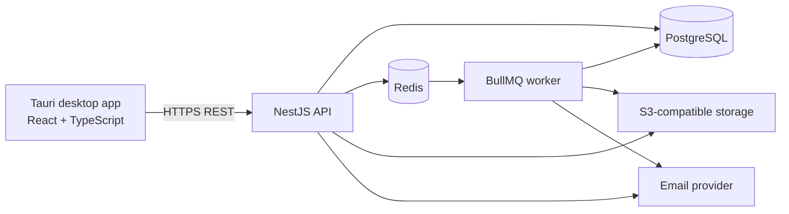

# Architecture Overview

## System shape

NerdHub starts as a **modular monolith** with a desktop client, API process and background worker. The API and worker share domain modules and database access but run as separate processes.

## Technology decisions

| Layer | Choice | Rationale |
|---|---|---|
| Desktop shell | Tauri 2 | Native desktop packaging with a web UI |
| UI | React + TypeScript + Vite | Mature ecosystem and reusable UI |
| Backend | NestJS | Structured modular Node backend |
| Database | PostgreSQL | Relational integrity and strong query support |
| ORM/migrations | Prisma | Typed access and migration workflow |
| Cache/queue | Redis + BullMQ | Background jobs and transient coordination |
| API | REST + OpenAPI 3.1 | Clear client/server boundary |
| Storage | S3-compatible | Portable object storage |
| Monorepo | pnpm + Turborepo | Shared packages and task orchestration |

Pin exact versions during M0 and commit all lockfiles.

## Logical backend modules

- Identity: accounts, sessions, OAuth linking and recovery.
- Profiles: public profile and preferences.
- Taxonomy: topics, tags and follows.
- Feed: following/latest queries and ranking policy.
- Content: posts, comments, reactions, bookmarks.
- Publishing: articles and revisions.
- Idea Lab: ideas, collaborators and updates.
- Gamification: XP, achievements, progression and leaderboards.
- Cosmetics: catalogue, ownership and equipment.
- Assets: upload authorization and metadata.
- Notifications: in-app notifications and preferences.
- Moderation: reports, blocks, actions and audit records.
- Admin: restricted operational controls.

Modules communicate through explicit application/domain interfaces. Avoid circular imports and direct cross-module table manipulation where a module API is available.

## Trust boundaries

- The desktop renderer is untrusted.
- The API validates identity, ownership, permissions and business rules.
- The worker processes trusted internal jobs but must still validate job payloads.
- Object storage is private by default; access is mediated by short-lived authorized URLs or API downloads.
- OAuth provider credentials remain server-side.
- User-generated text, URLs and files are untrusted.

## Data flow

1. Client sends a versioned API request over TLS.
2. API authenticates the session and validates input.
3. Domain service enforces ownership, authorization and invariants.
4. Database transaction commits durable state.
5. An outbox/job record is written transactionally where asynchronous work is needed.
6. Worker performs retryable side effects with idempotency.
7. Client reads the resulting state through API queries.

## Scalability and deployment

Start with one deployable API and one worker process. Scale API and worker horizontally only when measured load requires it. Use managed PostgreSQL/Redis or self-hosted services based on operational capacity. Keep object storage behind an S3-compatible abstraction.

## Architecture change policy

Any change to a core technology, trust boundary, deployment topology or domain ownership requires an ADR. Do not introduce microservices because of hypothetical scale.
