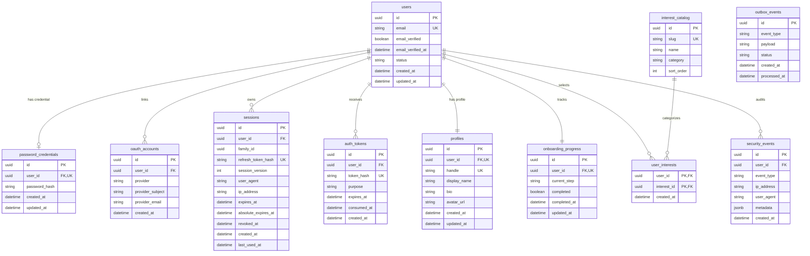

# Database Design Specification (Milestone M1)

> **Document Status:** PROPOSED — NOT MIGRATED
> **Milestone:** M1 — Identity and Onboarding
> **Target ORM:** Prisma with PostgreSQL
> **Last Updated:** 2026-11-09
> **Notice:** This schema is a proposed architectural blueprint. No database migrations have been generated or applied for M1.

---

## 1. Schema Overview

The M1 Identity and Onboarding subsystem introduces a normalized relational schema designed around an immutable identity anchor (`users`), strict separation of sensitive authentication credentials, append-only security logs, and transactional outbox events.

---

## 2. Table Specifications & Constraints

### 2.1 `users` (Identity Anchor)

- **`id`** (`UUID`, Primary Key, default `gen_random_uuid()`): Immutable unique identifier used throughout all system relationships.
- **`email`** (`VARCHAR(255)`, Unique, Not Null): Case-insensitive email address. Must be stored normalized (lowercased, trimmed).
- **`email_verified`** (`BOOLEAN`, Not Null, default `false`): Reflects email confirmation state.
- **`email_verified_at`** (`TIMESTAMPTZ`, Nullable): Timestamp of successful email verification.
- **`status`** (`VARCHAR(32)`, Not Null, default `'ACTIVE'`): State machine enum (`ACTIVE`, `SUSPENDED`, `DELETED`).
- **`created_at`** / **`updated_at`** (`TIMESTAMPTZ`, Not Null, UTC).

### 2.2 `password_credentials` (Decoupled Password Store)

- **`id`** (`UUID`, Primary Key).
- **`user_id`** (`UUID`, Foreign Key $\to$ `users.id` on delete cascade, Unique).
- **`password_hash`** (`VARCHAR(255)`, Not Null): Argon2id PHC string (`$argon2id$v=19$m=65536,t=3,p=1$...`).
- **`created_at`** / **`updated_at`** (`TIMESTAMPTZ`, Not Null).

### 2.3 `oauth_accounts` (Federated Provider Links)

- **`id`** (`UUID`, Primary Key).
- **`user_id`** (`UUID`, Foreign Key $\to$ `users.id` on delete cascade).
- **`provider`** (`VARCHAR(32)`, Not Null): Provider identifier (`'github'`, `'google'`).
- **`provider_subject`** (`VARCHAR(255)`, Not Null): Immutable identifier assigned by provider (e.g. GitHub numeric user ID, Google OIDC `sub`).
- **`provider_email`** (`VARCHAR(255)`, Nullable): Email address reported by provider at time of linking.
- **Unique Constraint:** `UNIQUE (provider, provider_subject)` ensures an external identity maps to exactly one user account.

### 2.4 `sessions` (Session Families & Refresh Tokens)

- **`id`** (`UUID`, Primary Key).
- **`user_id`** (`UUID`, Foreign Key $\to$ `users.id` on delete cascade).
- **`family_id`** (`UUID`, Not Null): Token family identifier generated on login; preserved across routine refresh rotations.
- **`refresh_token_hash`** (`VARCHAR(64)`, Unique, Not Null): Hex-encoded SHA-256 digest of active refresh token.
- **`session_version`** (`INT`, Not Null, default 1): Monotonically increasing counter; synchronized with Redis for bounded JWT revocation.
- **`user_agent`** / **`ip_address`** (`VARCHAR`, Nullable): Client telemetry for session listing.
- **`expires_at`** (`TIMESTAMPTZ`, Not Null): Sliding expiration (30 days from last refresh).
- **`absolute_expires_at`** (`TIMESTAMPTZ`, Not Null): Hard session expiration (90 days from initial creation).
- **`revoked_at`** (`TIMESTAMPTZ`, Nullable): Revocation timestamp; null indicates an active session.
- **`revocation_reason`** (`VARCHAR(64)`, Nullable): Reason for revocation (`'USER_LOGOUT'`, `'GLOBAL_LOGOUT'`, `'REPLAY_DETECTED'`, `'SESSION_LIMIT_EXCEEDED_EVICTION'`).
- **`created_at`** / **`last_used_at`** (`TIMESTAMPTZ`, Not Null, UTC).

### 2.5 `auth_tokens` (Hashed Verification & Reset Tokens)

- **`id`** (`UUID`, Primary Key).
- **`user_id`** (`UUID`, Foreign Key $\to$ `users.id` on delete cascade).
- **`token_hash`** (`VARCHAR(64)`, Unique, Not Null): Hex-encoded SHA-256 digest of the one-time token.
- **`purpose`** (`VARCHAR(32)`, Not Null): Token scope (`'EMAIL_VERIFICATION'`, `'PASSWORD_RESET'`).
- **`expires_at`** (`TIMESTAMPTZ`, Not Null): Strict expiration timestamp.
- **`consumed_at`** (`TIMESTAMPTZ`, Nullable): Timestamp when redeemed.

### 2.6 `profiles` (Public Identity)

- **`id`** (`UUID`, Primary Key).
- **`user_id`** (`UUID`, Foreign Key $\to$ `users.id` on delete cascade, Unique).
- **`handle`** (`VARCHAR(30)`, Unique, Not Null): Lowercase alphanumeric username (`^[a-z0-9_]{3,30}$`).
- **`display_name`** (`VARCHAR(50)`, Not Null): Human display name.
- **`bio`** (`VARCHAR(160)`, Nullable): User headline or short bio.
- **`avatar_url`** (`VARCHAR(512)`, Nullable): S3 asset key or external avatar URL.

### 2.7 `onboarding_progress` (Server-Authoritative State)

- **`id`** (`UUID`, Primary Key).
- **`user_id`** (`UUID`, Foreign Key $\to$ `users.id` on delete cascade, Unique).
- **`current_step`** (`VARCHAR(32)`, Not Null, default `'PROFILE'`): State machine step (`'PROFILE'`, `'INTERESTS'`, `'COMPLETED'`).
- **`completed`** (`BOOLEAN`, Not Null, default `false`).
- **`completed_at`** (`TIMESTAMPTZ`, Nullable).

---

## 3. Indexing & Optimization Strategy

1. **`users.email` Index:** Case-insensitive B-Tree index on `LOWER(email)` to guarantee uniqueness and enable fast login lookups.
2. **`profiles.handle` Index:** Unique B-Tree index on `handle`.
3. **`sessions.refresh_token_hash` Index:** Unique hash index for $O(1)$ token lookup during refresh requests.
4. **`sessions.user_id` Index:** For efficient multi-device session listing and "logout all" revocation operations.
5. **`auth_tokens.token_hash` Index:** Unique index for single-use token consumption.
