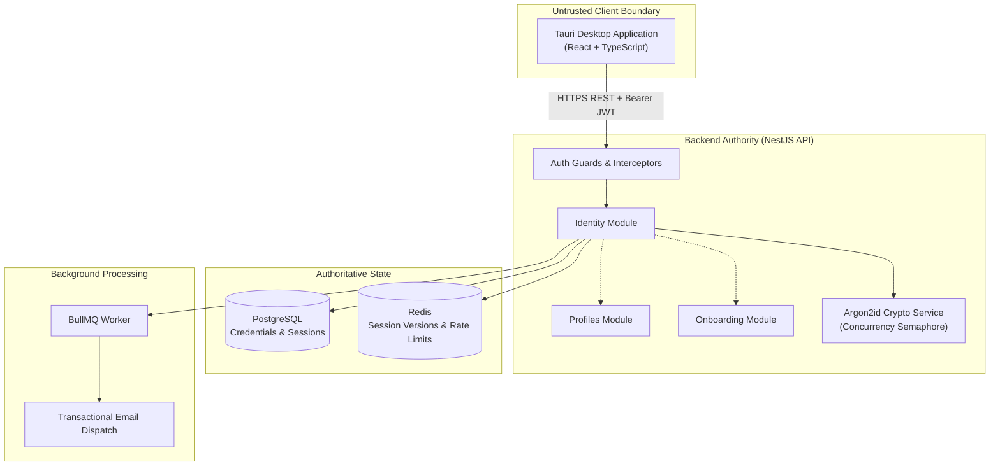
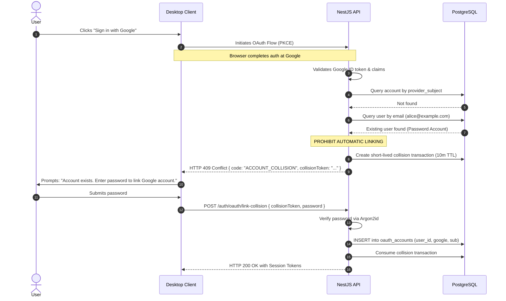

# Identity Architecture Specification

> **Document Status:** PROPOSED
> **Milestone:** M1 — Identity and Onboarding
> **Module:** Identity
> **Last Updated:** 2026-11-09

---

## 1. System Context & Trust Boundaries

The Identity subsystem manages user authentication, credential security, session lifecycles, and external OAuth delegations within the approved M0 modular monolith architecture.

### Trust Boundary Rules:

1. **Desktop Client is Untrusted:** The client never self-attests identity, permissions, email verification status, or administrative roles.
2. **Authoritative Backend:** The NestJS API verifies every request independently using JWT signatures and Redis session-version checks.
3. **Secret Isolation:** OAuth client secrets, session signing keys, and encryption keys reside strictly in backend environment variables and are never bundled into desktop distributions.
4. **Credential Decoupling:** Passwords are stored in a dedicated `password_credentials` table, physically separated from the primary `users` identity record.

---

## 2. Password Security & Concurrency Controls

### 2.1 Argon2id Parameter Baseline

NerdHub adopts the RFC 9106 recommended interactive parameters for Argon2id:

| Parameter             | Value               | Rationale                                                               |
| :-------------------- | :------------------ | :---------------------------------------------------------------------- |
| **Algorithm**         | Argon2id            | Hybrid mode resisting both side-channel and GPU/ASIC attacks            |
| **Memory Cost ($m$)** | 64 MiB (65,536 KiB) | Memory hardness bounding hardware cracking viability                    |
| **Time Cost ($t$)**   | 3 iterations        | ~100–300 ms computation time on standard server CPUs                    |
| **Parallelism ($p$)** | 1 lane              | Restricts per-hash thread allocation, avoiding threadpool fragmentation |

### 2.2 Threadpool Starvation Mitigation (Finding M1-CRIT-02)

Because the `argon2` native Node addon delegates hashing to the `libuv` threadpool:

1. **Application-Level Concurrency Semaphore:**
   - A concurrency gate limits concurrent password hashing executions to **4 simultaneous operations** across the API process.
   - A FIFO queue with a maximum depth of **8 requests** holds pending authentications.
   - Requests arriving when the queue is full are immediately rejected with HTTP `429 Too Many Requests` or `503 Service Unavailable`, preventing memory exhaustion.
   - A strict 5-second execution timeout releases the semaphore slot if a worker hangs.
2. **Runtime Threadpool Configuration (`UV_THREADPOOL_SIZE`):**
   - The primary protection against thread starvation is the application-level concurrency semaphore.
   - Any modification to `UV_THREADPOOL_SIZE` must be set prior to Node.js runtime initialization via environment variables (e.g. `UV_THREADPOOL_SIZE=8` or `16`).
   - Sizing must be verified through empirical benchmarking on target deployment hardware before finalizing production configuration; do not blindly impose `UV_THREADPOOL_SIZE=16` without evidence. Phase 1 implementation must run hashing benchmarks under concurrency to validate threadpool headroom.

---

## 3. Account Collision & Federated Linking (Finding M1-HIGH-02)

### 3.1 Collision State Machine

When an OAuth callback returns an email address that matches an existing account in PostgreSQL, automatic linking based purely on email is strictly prohibited to prevent account takeover.

### 3.2 Passwordless Existing Accounts

If the existing account was created via another OAuth provider (e.g. GitHub) and has no password:

1. The API detects absence of `password_credentials`.
2. The user is offered two options:
   - Authenticate with the primary linked provider (e.g. "Re-authenticate with GitHub").
   - Initiate a secure email challenge ("Send one-time linking link to your email").

---

## 4. Module Boundaries & Interactions

- **`IdentityModule`:** Owns authentication controllers, JWT signing, password verification, OAuth flows, and session lifecycle.
- **`ProfilesModule`:** Owns public user profiles, display names, avatars, and handle uniqueness checks.
- **`OnboardingModule`:** Owns onboarding step transitions, interest selections, and completion flags.
- **Transactional Consistency:** Account registration creates the `User`, `PasswordCredential`, `Profile`, and `OnboardingProgress` records inside a single PostgreSQL transaction to prevent orphaned partial state.
