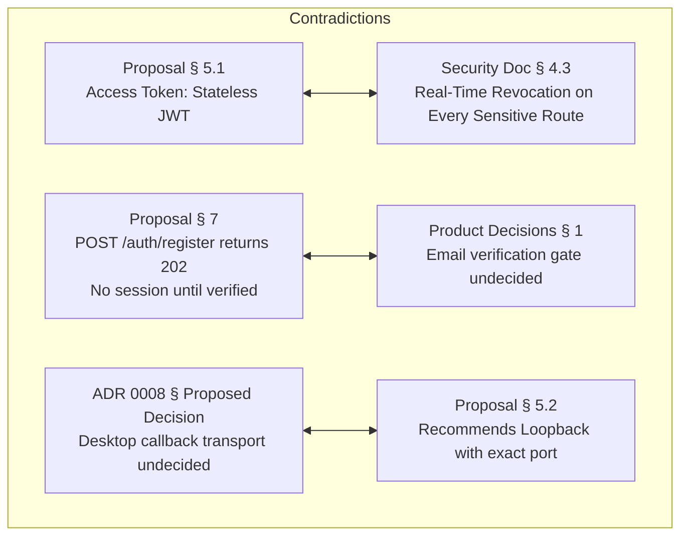
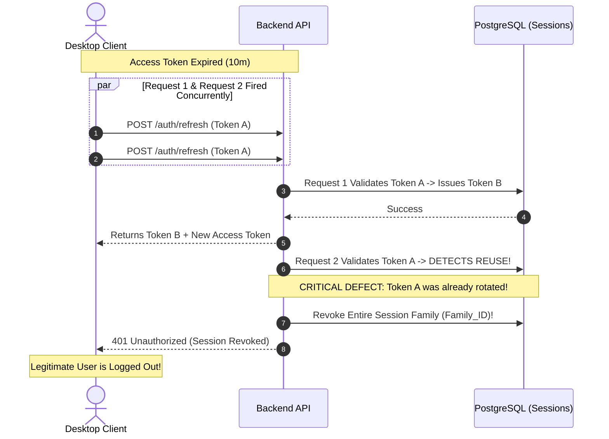
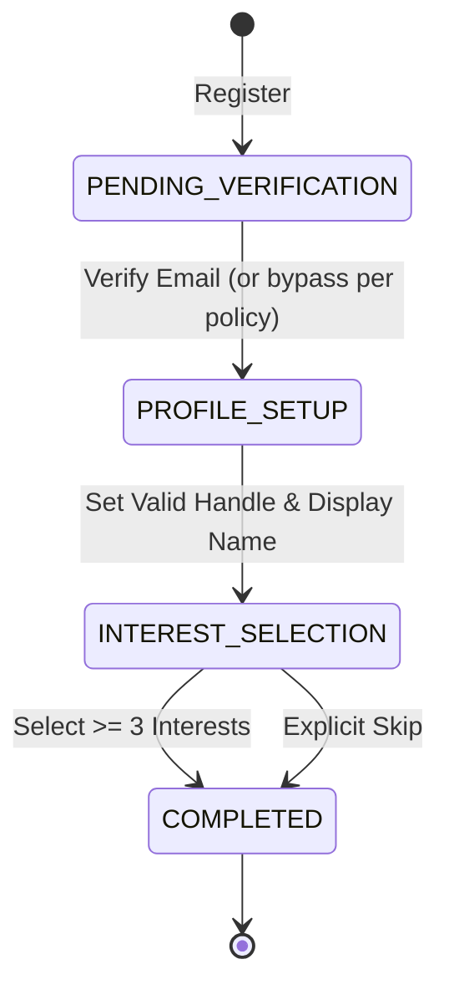

# NerdHub Milestone M1: Independent Architecture and Security Review

> **Document Status:** HISTORICAL RECORD — FIRST INDEPENDENT REVIEW (2026-11-09)
> **Original Finding:** REJECTED / BLOCKED
> **Notice:** This document is preserved for audit trail and compliance history. For the second independent review post-remediation, see [M1 Second Independent Review](M1_SECOND_INDEPENDENT_REVIEW.md).

**Review Date:** 2026-11-09
**Reviewer:** Independent Principal Software Architect & Application Security Engineer
**Milestone:** M1 — Identity and Onboarding
**Reviewed Artifacts:**

1. `docs/architecture/M1_IDENTITY_ONBOARDING_PROPOSAL.md`
2. `docs/architecture/adr/0008-m1-identity-session-and-desktop-auth-proposal.md`
3. `docs/engineering/M1_IDENTITY_SECURITY_AND_ACCEPTANCE.md`
4. `docs/product/M1_IDENTITY_ONBOARDING_PRODUCT_DECISIONS.md`

---

## 1. Executive Summary

Milestone M1 represents the critical trust boundary foundation for NerdHub. It defines the core identity, credential storage, session management, OAuth delegation, and onboarding pipelines upon which all future product modules (content, publishing, gamification, moderation, cosmetics) rely.

The proposal documents produced by Kilo demonstrate a commendable understanding of modern security principles—specifically rejecting password colocation on `users`, mandating Argon2id, prohibiting automatic email-based OAuth account linking, adopting PKCE for authorization code exchanges, and utilizing a database-backed refresh token rotation family model.

However, a rigorous independent technical audit reveals **severe architectural gaps, unmitigated concurrency failure modes, unresolved desktop transport mechanisms, and circular policy dependencies** that currently prevent implementation:

1. **Refresh Token Rotation Concurrency Collapse:** The proposed token family reuse detection lacks a concurrency grace window or mutex mechanism. In a multi-request desktop client, normal parallel requests occurring at access token expiry will trigger false-positive reuse detection, destroying the session family and abruptly logging out legitimate users.
2. **Desktop OAuth Transport Indecision in ADR 0008:** The Architecture Decision Record fails to decide between loopback listeners, custom URI schemes, and claimed HTTPS links, deferring the core native desktop architecture to an unmade decision.
3. **Account Collision Dead End:** The interaction between unique `users.email`, auto-provisioning, and the prohibition of automatic linking creates an unhandled dead end when an OAuth provider returns an email matching an existing password account.
4. **Node.js Threadpool Starvation under Argon2id:** The backend proposal mandates Argon2id without accounting for the Node.js `libuv` threadpool bottleneck (`UV_THREADPOOL_SIZE=4`), creating a severe Denial-of-Service vector under concurrent login traffic.
5. **Public Verification Resend Bombing:** `POST /auth/email-verification/request` is unauthenticated and lacks an account enumeration-resistant mailbox flood defense.
6. **Stateless JWT vs. Real-Time Revocation Contradiction:** The proposal claims access tokens are stateless signed JWTs, yet simultaneously claims real-time revocation for sensitive operations without specifying a distributed revocation cache (e.g., Redis bloom filter or revocation list).

---

## 2. Final Decision

### **FINAL DECISION: REJECTED / BLOCKED**

**Implementation must NOT proceed.** While the conceptual direction is sound, the architecture contains **Critical and High severity security and concurrency flaws** that must be resolved in revised documentation before code or migrations are created.

### Summary of Conditions Required for Unblocking:

1. Revise session management to include an atomic rotation lock and a 15–30 second rotation grace window to prevent concurrency collapse.
2. Formally decide and specify the Desktop OAuth transport in ADR 0008 (recommended: Custom URI scheme with PKCE-bound one-time completion codes).
3. Explicitly design the account collision state machine, UI flow, and error contracts for OAuth sign-in matching existing email accounts.
4. Define the Node.js runtime threadpool configuration and queue concurrency limits for Argon2id hashing.
5. Resolve the 13 outstanding human product decisions in `docs/product/M1_IDENTITY_ONBOARDING_PRODUCT_DECISIONS.md`.
6. Enforce M0 debt remediation (specifically MED-03 response envelopes and MED-05 database URL validation) as prerequisite tasks within M1.

---

## 3. Overall Architecture Assessment

### Preservation of M0 Architecture

The proposal successfully respects the M0 modular monolith architecture:

- Preserves the single deployable NestJS API process and separate BullMQ worker process.
- Retains PostgreSQL with Prisma and Redis with BullMQ.
- Maintains the strict boundary that the desktop renderer is an untrusted client that must never hold server secrets or make authorization decisions.

### Modular Monolith Boundaries

The proposed module breakdown (`identity`, `profiles`, `onboarding`, `email`, `audit`) is clean and avoids microservice fragmentation. However, boundary enforcement requires stricter discipline:

- `identity` owns authentication, sessions, and credentials.
- `profiles` owns public handles and display names.
- `onboarding` tracks the user's progress through initial setup.
- **Concern:** The proposal allows `identity` to create a `profile shell` and `onboarding_progress` record during registration within a single database transaction. While transactionally necessary, this must be handled via domain service events or explicit module interfaces rather than direct cross-module table writes.

### Future Multi-Client Feasibility

The architecture cleanly isolates client concerns. By avoiding desktop-specific assumptions in the core session service, future web clients can consume the identical session endpoints using `Set-Cookie` (`HttpOnly`, `Secure`, `SameSite=Strict`), while native clients consume the bearer token protocol via OS secure storage.

---

## 4. Cross-Document Consistency Review

A line-by-line comparison across the four documents revealed several direct contradictions and ambiguities:

1. **Stateless Tokens vs. Real-Time Revocation:**
   - `M1_IDENTITY_ONBOARDING_PROPOSAL.md` lines 61–63 states access tokens are signed stateless JWTs with 10-minute expiry.
   - `M1_IDENTITY_SECURITY_AND_ACCEPTANCE.md` item 43 requires that all protected endpoints derive identity from an authenticated server-side session and check revocation.
   - **Contradiction:** If every protected route queries PostgreSQL/Redis to check session revocation, the JWT is not stateless and incurs unnecessary signature verification overhead. If routes rely strictly on JWT signature verification, revocation cannot be immediate. The documents must explicitly document the trade-off: short-lived (5–10 min) unrevoked access tokens, or a Redis-backed revocation bloom filter.
2. **Registration Response and Session Issuance:**
   - `M1_IDENTITY_ONBOARDING_PROPOSAL.md` line 133 defines `POST /auth/register` as returning `202 Accepted` with no session.
   - `M1_IDENTITY_ONBOARDING_PRODUCT_DECISIONS.md` Decision 1 lists the verification gate as completely undecided ("Must email be verified before any session, before contributing, or only before sensitive changes?").
   - **Contradiction:** The API contract in the proposal assumes one specific answer (no session until verified), while the product decision document claims the decision is unmade.
3. **OAuth Desktop Transport:**
   - ADR 0008 lines 21–23 states the transport is an open approval gate.
   - The security document assumes a completion-code exchange with PKCE regardless of transport. The documents must align on a single adopted decision.

---

## 5. Authentication Architecture Review

### Email and Password Authentication

- **Account Anchor:** The use of an immutable UUID `users.id` with credentials stored in an auxiliary `password_credentials` table is architecturally superior to placing password hashes directly on `users`.
- **Argon2id Configuration:**
  - Recommended baseline: `Argon2id`, `memory: 64 MiB (65536 KiB)`, `iterations: 3`, `parallelism: 4` (RFC 9106 recommended interactive parameters).
  - **Critical Threadpool Bottleneck:** Node.js executes native crypto operations via the `libuv` threadpool. The default `UV_THREADPOOL_SIZE` is 4. Concurrently hashing 4 passwords completely blocks the threadpool, halting asynchronous file I/O, DNS lookups, and other native crypto.
  - **Required Mitigation:** The deployment configuration must explicitly set `UV_THREADPOOL_SIZE=16` or higher at process startup, and an application-level semaphore must bound concurrent password hashing requests to prevent thread starvation.
- **Password Policy:** The proposal's focus on length ($\ge 12$ characters) rather than arbitrary symbol/digit complexity complies with NIST SP 800-63B. Breached-password checks via k-Anonymity (HaveIBeenPwned API) are strongly recommended but must fail open with a timeout to prevent external outages from blocking registration.

### OAuth: GitHub and Google OpenID Connect

- **Identity Mapping:** Correctly maps provider accounts by immutable `provider_subject` (GitHub numeric ID, Google OIDC `sub`).
- **Signature & Claims Validation:** For Google, validating the ID token signature against cached JWKS, checking `iss` (`https://accounts.google.com`), `aud` matching client ID, `exp`, and `nonce` is mandatory and correctly specified.
- **Account Linking & Collision Handling (High Risk):**
  - The proposal correctly prohibits automatic account linking based on matching email addresses. This prevents pre-hijacking attacks where an attacker creates a NerdHub account with a victim's email, waiting for the victim to sign in via OAuth.
  - **Unresolved Dead End:** If a user already has an active password account with `alice@nerdhub.com` and subsequently clicks "Sign in with Google" (with verified email `alice@nerdhub.com`), the proposal states:
    1. The identity is not linked (`(google, sub)` not found).
    2. Auto-linking by email is forbidden.
    3. Auto-provisioning fails because `users.email` is unique.
  - **Result:** The user is locked out with an opaque error.
  - **Required Architectural Fix:** The API must return an explicit `409 ACCOUNT_COLLISION` response with a short-lived, signed `collision_token`. The desktop client presents a dedicated screen: _"An account with this email already exists. Enter your password to verify ownership and link Google sign-in."_ Upon successful password entry, the link is completed transactionally.

---

## 6. Session Management Review

### The Concurrency Race Condition (Critical Defect)

The proposal specifies:

> _"refresh rotation on every use; reuse of a previously rotated refresh token revokes the affected session family and records a security event."_

In any rich desktop application, views fire parallel API requests on mount (e.g., fetching profile, notifications, feed). When the 10-minute access token expires, multiple requests fail with 401 simultaneously and attempt to refresh.

- Under strict rotation, Request 1 rotates `Token_A` $\to$ `Token_B`.
- Request 2 arrives 20ms later with `Token_A`.
- The server flags `Token_A` as **reused**, revokes the entire `family_id`, and terminates the user's session.

### Required Architecture Fix:

1. **Rotation Grace Window:** When a refresh token is rotated, its digest is not deleted immediately. It is marked as `rotated` with a `grace_expires_at` timestamp (15–30 seconds).
2. If the rotated token is presented within the grace window, the server returns the **same newly issued tokens** from Request 1 without re-rotating or revoking the family.
3. If presented _after_ the grace window, it is treated as a malicious replay, triggering full family revocation.
4. **Client-Side Mutex:** The desktop `NerdHubApiClient` must implement an in-flight refresh mutex/promise queue so concurrent 401s await the single pending refresh call.

---

## 7. Desktop OAuth Security Review

### Comparative Evaluation of Transports

| Transport Mechanism                                  | Security Profile                                    | Implementation Complexity                                                             | Portability (Linux/macOS/Windows)                                                                                     | Recommendation                               |
| :--------------------------------------------------- | :-------------------------------------------------- | :------------------------------------------------------------------------------------ | :-------------------------------------------------------------------------------------------------------------------- | :------------------------------------------- |
| **1. Loopback Redirect** (`http://127.0.0.1:<port>`) | High (local socket isolation).                      | High (requires local HTTP server lifecycle, dynamic port binding, firewall handling). | Fair on Windows/macOS; poor on locked-down Linux/enterprise endpoints. Chrome PNA blocks web-to-loopback navigations. | Rejected as primary.                         |
| **2. Custom URI Scheme** (`nerdhub://auth/callback`) | Medium-High (when bound with PKCE completion code). | Low-Medium (standard OS protocol handler via Tauri deep-link plugin).                 | Excellent (natively supported across Linux X11/Wayland, macOS, Windows).                                              | **RECOMMENDED PRIMARY**                      |
| **3. Claimed HTTPS Links** (Universal/App Links)     | Very High (domain-verified ownership).              | Very High (requires domain assetlinks/AASA hosting and OS association).               | Windows/macOS only. **Unsupported on Linux desktop** (no standard OS link claiming).                                  | Incompatible with Linux desktop requirement. |

### Architectural Recommendation: Custom URI Scheme + PKCE Completion Code

The custom scheme hijack threat is completely mitigated by the proposed **two-step completion code + PKCE architecture**:

1. Desktop generates a cryptographically secure random verifier $V$ and computes $C = \text{Base64URL}(\text{SHA256}(V))$.
2. Desktop stores $V$ in memory and initiates the transaction with $C$.
3. Provider redirects to the HTTPS API callback.
4. The API issues a short-lived (60s), single-use `completion_code` and redirects the system browser to `nerdhub://auth/callback?code=...`.
5. Even if a malicious application running on the local OS intercepts `nerdhub://` and steals the `completion_code`, it **cannot exchange it** at `POST /auth/oauth/complete` because it does not possess the secret verifier $V$.
6. Desktop exchanges `(completion_code, V)` for the session tokens.

This provides ironclad security while ensuring 100% portability across all supported desktop platforms.

---

## 8. Database and API Review

### Entity-Relationship Model

The proposed 13 tables are well-normalized:

- `users` (Identity anchor)
- `password_credentials` (1:1 with user)
- `oauth_accounts` (1:N with user, unique per `(provider, provider_subject)`)
- `sessions` (1:N with user, includes `family_id` and rotation counter)
- `auth_tokens` (Hashed verification and reset tokens)
- `oauth_transactions` (Short-lived PKCE/state store)
- `oauth_completion_codes` (One-time desktop handoff)
- `profiles` (1:1 with user, handles `handle` uniqueness)
- `onboarding_progress` (Server-side onboarding state)
- `interest_catalog` (Curated catalogue)
- `user_interests` (N:M join table with optional ranking)
- `security_events` (Append-only audit log)
- `outbox_events` (Transactional email queue)

### Critical Schema Constraints & Indexing Requirements

1. `profiles.handle`: Must use `citext` with a unique index. A database-level check constraint must enforce `LENGTH(handle) >= 3 AND LENGTH(handle) <= 30 AND handle ~ '^[a-z0-9_]+$'`.
2. `sessions.refresh_token_hash`: Must be indexed for fast lookup on refresh.
3. `auth_tokens.token_hash`: Must have a composite unique index on `(token_hash, purpose)`.
4. `user_interests`: Primary key must be composite `(user_id, interest_id)`.
5. **No Soft Delete for Credentials:** While `users` may have a `status = 'deleted'`, credentials (`password_credentials`, `oauth_accounts`, `sessions`) must be purged or cryptographically scrambled upon account deletion.

---

## 9. Onboarding Review

### Server-Authoritative State Machine

Onboarding state must live strictly on the server in `onboarding_progress`:

### Uniqueness and Normalization Rules

- **Display Name vs. Handle:** Display names allow Unicode, spaces, and casing (max 50 chars). Handles must be strictly normalized ASCII (`^[a-z0-9_]{3,30}$`), lowercased, and checked against a reserved word list (`admin`, `nerdhub`, `api`, `moderator`, `help`, `root`).
- **Resumability:** If a user closes the desktop app during interest selection, their next login reads `onboarding_progress` from `GET /me` and routes them directly back to interest selection.

---

## 10. Detailed Threat Assessment (20 Attack Scenarios)

| #      | Attack Scenario           |  Impact  | Proposed Mitigation                | Missing Mitigation / Required Fix                                                         | Acceptance Test                                                                                    |
| :----- | :------------------------ | :------: | :--------------------------------- | :---------------------------------------------------------------------------------------- | :------------------------------------------------------------------------------------------------- |
| **1**  | Credential Stuffing       |   High   | Rate limits by IP and account.     | Distributed Redis sliding-window rate limiting; alert on sudden spike in 401s.            | Simulate 50 failed logins across 5 IPs; verify 429 lockout.                                        |
| **2**  | Brute-Force Login         |   High   | Generic invalid credentials error. | Progressive delay after 5 failed attempts on a single account.                            | Assert response time and status after repeated failures.                                           |
| **3**  | Password DB Theft         | Critical | Argon2id hashing.                  | Benchmark params ($m=64\text{MB}, t=3, p=4$); apply global server pepper via HMAC.        | Verify database dump yields only salted PHC strings.                                               |
| **4**  | Refresh Token Theft       | Critical | OS Credential Store via Tauri.     | Never write tokens to localStorage/IndexedDB; encrypt in transit via TLS.                 | Inspect desktop renderer storage; verify zero tokens in localStorage.                              |
| **5**  | Refresh Token Replay      |   High   | Family revocation.                 | **Missing rotation grace period** (causes false positives); add 30s grace window.         | Replay used token outside grace window; verify all sessions in family revoked.                     |
| **6**  | OAuth CSRF                |   High   | Cryptographic random `state`.      | State must be single-use, stored with 5-minute TTL, and bound to browser session.         | Tamper with `state` in callback; assert 400 Bad Request.                                           |
| **7**  | OAuth Account Takeover    | Critical | Provider `sub` mapping only.       | Never trust provider email alone to link accounts.                                        | Register with target email on GitHub; verify login does not access existing NerdHub user.          |
| **8**  | Account-Linking Attack    |   High   | Authenticated linking only.        | Disallow unauthenticated linking; verify session ownership before linking.                | Attempt linking without valid bearer token; assert 401 Unauthorized.                               |
| **9**  | Email Enumeration         |  Medium  | Generic responses.                 | Registration, reset, and verification resend return identical `202 Accepted` responses.   | Send reset requests for existing and non-existing emails; assert identical response time and body. |
| **10** | Password-Reset Abuse      |   High   | Single-use expiring tokens.        | Token is hashed (SHA-256) in DB; 15-minute expiry; consumes all active sessions on reset. | Use reset token twice; assert second attempt fails. Verify old sessions 401.                       |
| **11** | Verification Token Theft  |   High   | Hashed tokens, short TTL.          | Digested storage; single-use transaction.                                                 | Query `auth_tokens` table; verify raw token is not stored.                                         |
| **12** | Session Fixation          |   High   | Session recreation on login.       | Invalidate any pre-auth session identifier; generate fresh `family_id` on login.          | Verify session ID changes before and after authentication.                                         |
| **13** | Deep-Link Interception    |   High   | One-time completion code.          | Completion code must be exchanged with original PKCE verifier $V$.                        | Intercept completion code; attempt exchange without $V$; assert 400 error.                         |
| **14** | Renderer Compromise       |   High   | Least-privilege IPC.               | Tauri bridge exposes only narrow named commands; no shell/FS access.                      | Audit `tauri.conf.json` and capability manifests for broad permissions.                            |
| **15** | Rate Limit Bypass         |  Medium  | Multi-keyed Redis counters.        | Key limits on `IP + Route` and `AccountHash + Route`.                                     | Rotate X-Forwarded-For; verify account-level rate limit still triggers.                            |
| **16** | Sensitive Info in Logs    |   High   | Structured Pino redaction.         | Pino redaction keys for `authorization`, `password`, `token`, `secret`.                   | Grep log output during auth test suite; assert zero matches for tokens/passwords.                  |
| **17** | Desktop Binary Secrets    | Critical | Server-side OAuth exchange.        | Provider client secrets stay on backend API; zero secrets in client bundle.               | Run `strings` and static scan on compiled desktop bundle; assert no provider secrets.              |
| **18** | Creation Race Conditions  |  Medium  | DB Unique Constraints.             | PostgreSQL `citext` unique constraints on `email` and `handle` with retry handling.       | Concurrently fire 10 identical registrations; assert exactly 1 succeeds, 9 fail safely.            |
| **19** | Concurrent Refresh/Logout |  Medium  | Database transaction.              | Mark session revoked atomically; concurrent refresh aborts cleanly.                       | Fire refresh and logout simultaneously; verify session is definitively revoked.                    |
| **20** | DB Failure on Rotation    |   High   | Transactional boundary.            | Session update and token outbox committed in a single atomic transaction.                 | Inject DB error during token update; assert old token remains valid.                               |

---

## 11. Product and Operational Decisions

The 13 decisions listed in `M1_IDENTITY_ONBOARDING_PRODUCT_DECISIONS.md` are critical. Implementation cannot proceed on assumptions. Below are the **Architectural Recommendations** for the product owner:

1. **Email Verification Gate:** **Recommend Gate Option B (Verification required before public contribution, but browsing/onboarding allowed).** Issuing a restricted session immediately upon registration maximizes activation while protecting community integrity.
2. **OAuth Auto-Provisioning:** **Recommend Allowed with Verified Provider Email Only.** If GitHub email is private, prompt the user during onboarding to provide and verify an email address.
3. **Desktop Callback:** **Recommend Custom URI Scheme (`nerdhub://auth/callback`) with PKCE Completion Code.** Highest cross-platform portability; immune to loopback firewall/PNA restrictions.
4. **Session Lifetimes:** **Recommend 15-minute Access Token, 30-day Refresh Token, 90-day Absolute Session Max.** Maximum 5 concurrent sessions per user.
5. **Password Policy:** **Recommend Min 12 chars, Max 128 chars.** Defer external HaveIBeenPwned API until M5 to eliminate external dependencies during bootstrap.
6. **Recovery Policy:** **Recommend Password reset revokes ALL existing sessions.** User must log in again with new password.
7. **OAuth Unlinking:** **Recommend Defer unlinking UI to M2.** Maintain invariant: account must have at least one usable authentication credential.
8. **Handle Policy:** **Recommend ASCII `[a-z0-9_]{3,30}`.** Forbid renames in M1.

---

## 12. M0 Compatibility Assessment

Milestone M1 builds directly upon M0. Outstanding M0 backlog items must be handled as follows:

- **MED-03 (Standard API Envelope & Request ID):** **MUST RESOLVE IN M1 (BLOCKER).** M1 adds 18 new endpoints. A global `TransformInterceptor` wrapping responses in `{ data: T, meta: { requestId } }` must be installed immediately before M1 endpoints are created to prevent breaking client contracts later.
- **MED-05 (`DATABASE_URL` Optional in Zod Schema):** **MUST RESOLVE IN M1 (BLOCKER).** Change `DATABASE_URL` in `apps/api/src/config/env.schema.ts` to `z.string().url()`.
- **MED-06 (Env error formatting):** Resolve during M1 config setup (`JSON.stringify(..., null, 2)`).
- **LOW-01 through LOW-06:** May safely remain deferred as non-blocking technical debt.

---

## 13. Missing or Weak Acceptance Criteria

The following acceptance criteria in the proposal are vague and must be replaced with verifiable assertions:

| Weak / Vague Proposal Statement                                                   | Precise, Verifiable Acceptance Criterion                                                                                                                                                                                                                                                                |
| :-------------------------------------------------------------------------------- | :------------------------------------------------------------------------------------------------------------------------------------------------------------------------------------------------------------------------------------------------------------------------------------------------------ |
| _"Registration must not reveal whether an address is registered when practical."_ | `POST /auth/register` with an existing email returns HTTP `200 OK` (or `202 Accepted`) with `{ "status": "pending_verification" }`. No account is created, but a verification notice is sent to the existing account holder. Response time must not differ by $>50\text{ms}$ from a fresh registration. |
| _"Argon2id parameters are approved and benchmarked."_                             | Argon2id hashing must take between $200\text{ms}$ and $500\text{ms}$ on target production hardware with memory set to $65536\text{ KiB}$, time cost $3$, and parallelism $4$.                                                                                                                           |
| _"Refresh rotation is atomic; reuse revokes the session family."_                 | Presenting a rotated refresh token after the 30-second grace period returns HTTP `401 Unauthorized` with code `TOKEN_REUSE_DETECTED`. All sessions sharing the same `family_id` must have `revoked_at` set to current timestamp within the same database transaction.                                   |
| _"Username normalization is deterministic."_                                      | `PATCH /me/profile` with handle `Alice_01` stores `alice_01`. Attempting to register `ALICE_01` returns HTTP `409 Conflict` with code `HANDLE_UNAVAILABLE`.                                                                                                                                             |

---

## 14. Findings Register

| Finding ID       |   Severity   | Document & Section                    | Problem Summary                                                             | Why It Matters                                                                                              | Required Resolution                                                                                      | Blocks M1? |
| :--------------- | :----------: | :------------------------------------ | :-------------------------------------------------------------------------- | :---------------------------------------------------------------------------------------------------------- | :------------------------------------------------------------------------------------------------------- | :--------: |
| **[M1-CRIT-01]** | **Critical** | Proposal § 5.1, ADR 0008              | Strict refresh rotation lacks concurrency grace window.                     | Concurrent client requests at access token expiry cause false reuse detection and log out legitimate users. | Implement 30s rotation grace window and client refresh mutex.                                            |  **YES**   |
| **[M1-CRIT-02]** | **Critical** | Proposal § 3, Security § Threat Model | Node `libuv` threadpool starvation during Argon2id hashing.                 | 4 concurrent logins block the entire Node I/O threadpool, causing API denial of service.                    | Configure `UV_THREADPOOL_SIZE >= 16` and implement login concurrency semaphore.                          |  **YES**   |
| **[M1-HIGH-01]** |   **High**   | ADR 0008, Proposal § 5.2              | Desktop OAuth callback transport is unresolved in ADR.                      | ADR 0008 fails to decide architecture; cannot implement without approved transport.                         | Formally adopt Custom URI Scheme with PKCE completion code in ADR 0008.                                  |  **YES**   |
| **[M1-HIGH-02]** |   **High**   | Proposal § 4.1                        | Account collision flow between OAuth and existing email is undefined.       | Users attempting OAuth with existing email hit unhandled uniqueness collision and cannot log in.            | Define collision state machine, `409 ACCOUNT_COLLISION` error, and password linking flow.                |  **YES**   |
| **[M1-HIGH-03]** |   **High**   | Proposal § 7                          | `POST /auth/email-verification/request` enables mailbox flooding.           | Unauthenticated endpoint allows attackers to spam victim inboxes with verification mail.                    | Require session for verification resend or enforce strict IP/Target email rate limit.                    |  **YES**   |
| **[M1-HIGH-04]** |   **High**   | Proposal § 5.1, Security § 4.3        | Contradiction between stateless JWT access tokens and real-time revocation. | Security doc claims real-time revocation, but proposal relies on stateless JWTs.                            | Formally document that access tokens have bounded revocation latency (10m) or use Redis revocation list. |  **YES**   |
| **[M1-MED-01]**  |  **Medium**  | Proposal § 7                          | M0 backlog item MED-03 (response envelopes) deferred.                       | Adding 18 endpoints without standard envelope creates massive breaking change in M2.                        | Enforce NestJS `TransformInterceptor` at start of M1.                                                    |  **YES**   |
| **[M1-MED-02]**  |  **Medium**  | Proposal § 6                          | `onboarding_progress` state machine transitions not formally defined.       | Ambiguity on which transitions are valid and whether skipped onboarding can be resumed.                     | Define explicit enum states and transition guard rules in proposal.                                      |     No     |
| **[M1-MED-03]**  |  **Medium**  | Proposal § 4                          | Missing/private GitHub email behavior undefined.                            | OAuth sign-up crashes or creates email-less account if GitHub user hides email.                             | Prompt user for email during onboarding if provider does not return verified email.                      |     No     |
| **[M1-LOW-01]**  |   **Low**    | Proposal § 6                          | Reserved handle list not published.                                         | Attackers can claim `admin`, `api`, or `system` handles.                                                    | Publish reserved handle dictionary in profile specification.                                             |     No     |

---

## 15. Required Changes Before Approval

Before M1 architecture approval can be granted, the author must submit a revised proposal satisfying these exact conditions:

1. **Add Session Rotation Grace Window:** Update session rotation specification to include `rotated_at` and `grace_expires_at` (30 seconds) on rotated tokens to prevent race-condition logouts.
2. **Decide Desktop OAuth Transport in ADR 0008:** Update ADR 0008 to **Accepted** status, adopting the **Custom URI Scheme (`nerdhub://auth/callback`) + PKCE One-Time Completion Code** pattern.
3. **Specify OAuth Account Collision Flow:** Document the API contract and user journey when an OAuth email matches an existing password account.
4. **Define Argon2id Operational Guardrails:** Specify `UV_THREADPOOL_SIZE` adjustments, thread bounds, and memory cost ($64\text{MB}$) in deployment guidelines.
5. **Secure Verification Resend:** Bound `POST /auth/email-verification/request` behind an account-level rate limit and require prior authentication or proof-of-work/re-CAPTCHA escalation if public.
6. **Resolve Product Decisions 1 through 8:** The product owner must explicitly approve decisions regarding verification gating, auto-provisioning, session lifetimes, and handle rules.

---

## 16. Recommended Improvements

- **Redis Session Caching:** Consider caching active session validity in Redis (`session:{id}:valid = 1`) with TTL matching the access token lifetime to enable sub-millisecond revocation checks without hitting PostgreSQL.
- **Transactional Outbox for Audit Logs:** Route critical security audit events through the PostgreSQL `outbox_events` table to ensure audit records cannot be dropped if logging aggregators fail.
- **Client Refresh Pre-emption:** Have the desktop client refresh tokens proactively at 80% of access token lifetime (e.g., at minute 8 of 10) to prevent 401s during user workflows.

---

## 17. Human Decisions Required

The product owner must make and record the following binding decisions in `docs/product/M1_IDENTITY_ONBOARDING_PRODUCT_DECISIONS.md`:

1. **Email Verification Requirement:** Adopt Option B (allow login and profile setup, but block public posting until verified).
2. **First-Time OAuth Account Creation:** Allow automatic creation if provider email is verified; prompt for email if provider email is private/unverified.
3. **Session Lifetimes:** Approve 15-minute access token, 30-day idle refresh, 90-day absolute session maximum.
4. **Password Length:** Approve minimum 12 characters, maximum 128 characters.
5. **Handle Rename Policy:** Approve that handles are immutable in M1.

---

## 18. Final Sign-Off

**Status:** ❌ **REJECTED / BLOCKED**
The Milestone M1 Identity and Onboarding architecture is **not approved for implementation**. Revision and remediation of findings **[M1-CRIT-01]** through **[M1-HIGH-04]** are required before re-audit.

_Signed,_
**Independent Principal Software Architect & Application Security Engineer**
NerdHub Review Board
