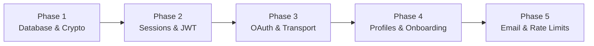

# M1 Identity & Onboarding — Implementation Plan

> **Document Status:** AUTHORIZED — IN PROGRESS
> **Milestone:** M1 — Identity and Onboarding
> **Prerequisites:** Project owner approval of Decisions M1-P-01 through M1-P-04 (ACCEPTED 2026-11-10); ADR 0008 marked Accepted (2026-11-10). Both prerequisites satisfied.
> **Last Updated:** 2026-11-10

---

## 1. Execution Philosophy

Implementation for Milestone M1 must proceed in five strictly sequenced, test-driven phases. Each phase establishes a verified security boundary before the next phase builds upon it.

---

## 2. Phased Implementation Roadmap

### Phase 1: Database Schema & Cryptographic Foundation

1. **Prisma Migration:**
   - Define M1 models in `prisma/schema.prisma` (`User`, `PasswordCredential`, `OAuthAccount`, `Session`, `AuthToken`, `Profile`, `OnboardingProgress`, `InterestCatalog`, `UserInterest`, `SecurityEvent`, `OutboxEvent`).
   - Generate and apply migration: `0002_m1_identity_foundation`.
2. **Cryptographic Service:**
   - Implement `CryptoService` in `apps/api/src/identity/crypto.service.ts`.
   - Wrap Argon2id hashing with application-level concurrency semaphore (cap 4, queue depth 8, timeout 5s).
   - Document and verify `UV_THREADPOOL_SIZE=16` in process bootstrap.
3. **Validation & Contracts:**
   - Define shared Zod schemas in `packages/contracts/src/identity/`.

### Phase 2: Session Management & Access Guards

1. **Session Service:**
   - Implement `SessionService` in `apps/api/src/identity/session.service.ts`.
   - Implement atomic refresh rotation with `SELECT FOR UPDATE` and token family reuse detection.
   - Implement 30-second idempotency response cache for token refresh.
   - Configure Redis session-version invalidation for bounded JWT revocation.
2. **NestJS Guards & Passport:**
   - Implement `JwtAuthGuard` checking signature, expiration, and Redis `session_version`.
   - Implement client-side single-flight refresh mutex in `packages/api-client`.

### Phase 3: Desktop OAuth & Deep-Link Transport

1. **OAuth Initiation & Callback:**
   - Implement `GET /api/v1/auth/oauth/:provider` with PKCE challenge generation.
   - Implement `GET /api/v1/auth/oauth/:provider/callback` with provider claim verification.
   - Implement one-time completion code generation (60s TTL).
2. **Collision State Machine:**
   - Implement `409 ACCOUNT_COLLISION` detection and password linking endpoint.
3. **Desktop Native Protocol:**
   - Configure Tauri deep-link plugin for `nerdhub://auth/callback`.
   - Implement desktop completion code exchange via `POST /api/v1/auth/oauth/complete`.

### Phase 4: Profiles & Onboarding State Machine

1. **Profiles Service:**
   - Implement handle validation (ASCII `[a-z0-9_]{3,30}`) and reserved word filtering.
   - Seed `interest_catalog` table with curated primary disciplines.
2. **Onboarding State Machine:**
   - Implement `OnboardingService` tracking progress steps (`PROFILE`, `INTERESTS`, `COMPLETED`).
   - Implement `GET /api/v1/me` and interest selection / skip endpoints.
   - Wire desktop shell to auto-route uncompleted onboarding states.

### Phase 5: Email Verification, Password Reset & Rate Limiting

1. **BullMQ Mailer Queue:**
   - Define email dispatch job processor in `apps/worker/src/queue/mailer.job.ts`.
   - Connect transactional email provider adapter.
2. **Distributed Abuse Controls:**
   - Implement Redis sliding-window rate limit guard for login, registration, and verification resend.
   - Implement enumeration-resistant responses and audit logging to `security_events`.
3. **Full Security Audit & Verification:**
   - Execute test pyramid (unit, integration, load, security).
   - Verify zero compiler warnings, zero lint errors, and 100% acceptance criteria pass rate.
