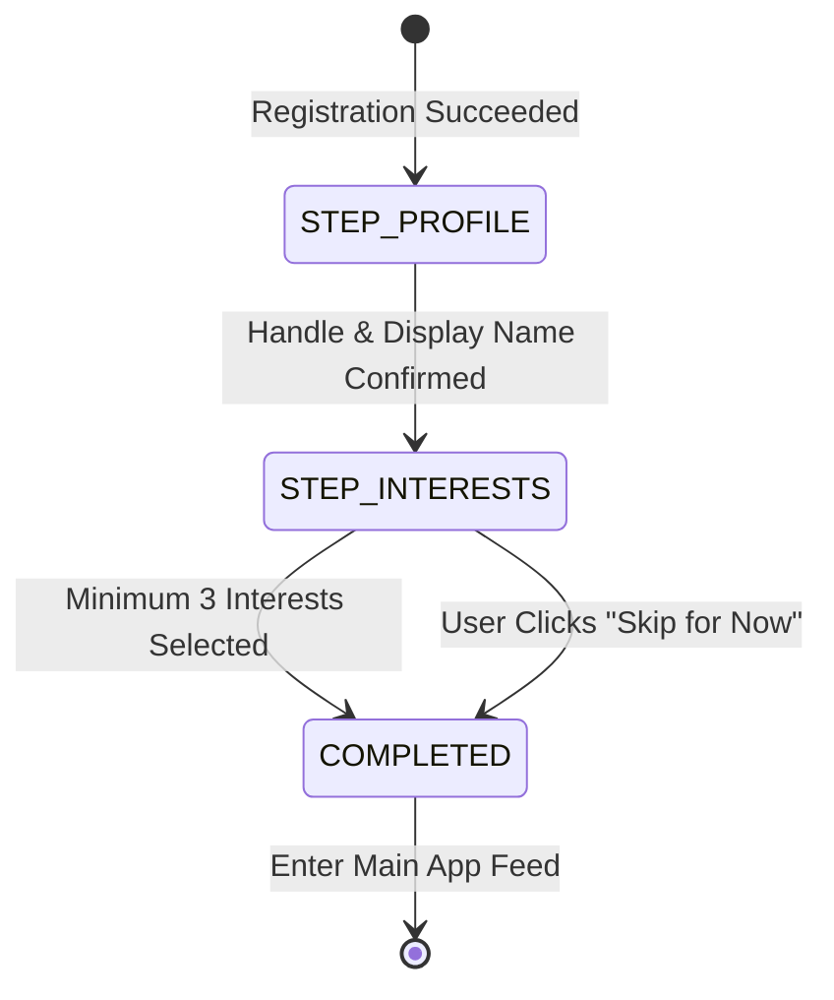

# Onboarding Product Requirements

> **Document Status:** PROPOSED — PENDING OWNER APPROVAL
> **Milestone:** M1 — Identity and Onboarding
> **Module:** Onboarding & Profiles
> **Last Updated:** 2026-11-09

---

## 1. Overview

The Onboarding journey guides newly registered users through establishing their public identity, selecting topics of interest, and preparing their workspace.

Onboarding state is server-authoritative and persistent: if a user closes the desktop application during onboarding, the application resumes at the exact step where they left off upon next launch.

---

## 2. Onboarding Steps & State Machine

### 2.1 Step 1: Profile Initialization

1. **Handle (@username):**
   - Pre-populated with sanitized suggestions from registration or OAuth profile.
   - User may customize the handle subject to [Decision M1-P-04](PRODUCT_DECISIONS.md#decision-m1-p-04--username--handle-policy):
     - Length: 3 to 30 characters.
     - Characters: Lowercase ASCII alphanumeric plus underscores (`[a-z0-9_]`).
     - Must be globally unique.
     - Must not match reserved system terms (`admin`, `nerdhub`, `mod`, `api`, `root`, etc.).
   - Live validation displays availability status without allowing automated mass handle enumeration.
2. **Display Name:**
   - Free-form text, up to 50 characters.
   - Supports Unicode, mixed-case, and spaces.
   - Defaults to the handle if not provided.
3. **Bio / Headline (Optional):**
   - Free-form text, up to 160 characters.

### 2.2 Step 2: Interest Selection

1. **Catalogue Presentation:**
   - Presents curated primary domains: Mathematics, Computer Science, Physics, Hardware/Robotics, Philosophy, Artificial Intelligence, Biology, Astronomy, Engineering, Open Source.
   - Each category displays sub-topics and tags.
2. **Selection Rules:**
   - Users are prompted to select at least 3 interests to initialize their personal feed.
   - Search filter allows rapid discovery of niche subjects.
3. **Skipping:**
   - An explicit "Skip for now" control is available.
   - If skipped, the home feed defaults to the general "Explore" / "Trending" discovery feed.

---

## 3. Server-Side State Tracking

- The user's progress is tracked in the database table `onboarding_progress`.
- Fields: `user_id`, `current_step` (`PROFILE`, `INTERESTS`, `COMPLETED`), `completed_at`, `skipped_interests`.
- Every authenticated request to `GET /api/v1/me` returns the current onboarding status.
- The desktop shell checks `me.onboarding.completed`:
  - If `false`, navigation redirects to the active onboarding step.
  - If `true`, the user lands directly in the main application shell.

---

## 4. UI & Accessibility Requirements

- **Keyboard Navigation:** Full tab navigation across all form controls, chips, and buttons.
- **Visual Feedback:** Clear inline error messages on handle validation without layout shift.
- **Dark/Light Mode:** Full adherence to system theme and theme toggle setting.
- **Reduced Motion:** Respects `prefers-reduced-motion` for transitions between onboarding steps.
